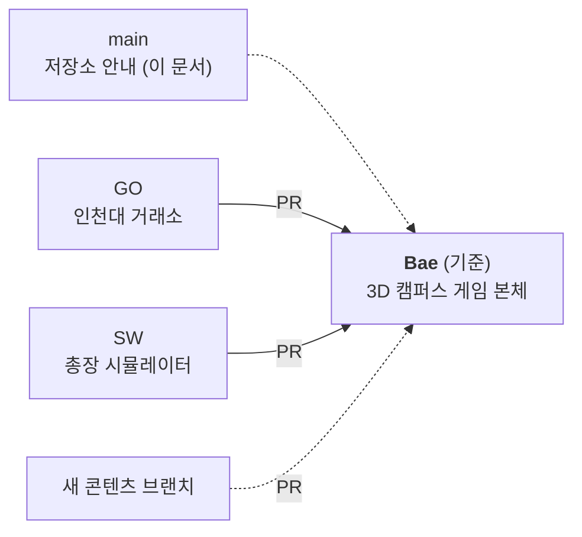

# 다시 사는 대학생활

> 인천대학교 정보기술대학 공모전 「AI로 다시 쓰는 대학생활」 출품작
> 문제 해결을 넘어, 새로운 경험을 만드는 창의적인 웹

인천대 송도캠퍼스를 3D로 옮겨 놓은 캠퍼스에서 신입생부터 졸업, 대학원까지 대학 생활을 압축해서 다시 살아 보는 웹게임입니다. 기본 게임 위에 팀원들이 만든 콘텐츠(총장 시뮬레이터, 인천대 거래소 등)를 하나씩 얹는 방식으로 개발하고 있습니다.

---

## 브랜치 구조

**`Bae` 브랜치가 기준입니다.** 3D 캠퍼스 게임 본체가 `Bae`에 있고, 다른 브랜치에서 만든 콘텐츠는 `Bae`로 합쳐서 게임 안의 콘텐츠로 추가합니다. `main`에는 이 안내 문서만 두고, 코드는 올리지 않습니다.



| 브랜치 | 담당 | 내용 | 상태 |
| --- | --- | --- | --- |
| [`Bae`](https://github.com/ssa1monn/TakeTheToken/tree/Bae) | oi-RYH | 다시 사는 대학생활: 3D 캠퍼스 웹게임 본체 | 기준 브랜치 |
| [`GO`](https://github.com/ssa1monn/TakeTheToken/tree/GO) | 고우석 | 인천대 거래소: 교수님 주가 중심 캠퍼스 증권 데모 | `Bae` 통합 전 |
| [`SW`](https://github.com/ssa1monn/TakeTheToken/tree/SW) | 박상원 | 총장 시뮬레이터: 학교 안건을 결재하는 웹 데모 | `Bae` 통합 전 |
| `main` | 공동 | 저장소 안내 문서(README)만 둡니다 | 코드는 올리지 않음 |

---

## 작업 흐름

1. **`Bae`에서 출발합니다.** 새 콘텐츠는 항상 최신 `Bae`에서 브랜치를 따서 만듭니다.
2. **각자 브랜치에서 콘텐츠를 만듭니다.** 다른 사람 브랜치의 파일은 직접 고치지 않습니다.
3. **완성되면 `Bae`로 Pull Request를 올립니다.** 게임 본체와 연결하는 작업(건물 진입, 이벤트 등록)은 PR 안에서 같이 합니다.
4. **리뷰 후 `Bae`에 머지합니다.** 머지된 뒤에는 각자 브랜치를 `Bae` 기준으로 다시 맞춥니다.

```bash
# 1. 최신 Bae에서 새 브랜치 만들기
git switch Bae
git pull
git switch -c 내-콘텐츠-브랜치

# 2. 작업 후 커밋
git add <바꾼 파일>
git commit -m "무엇을 추가했는지 한국어로"

# 3. 올리고 GitHub에서 Bae로 PR 만들기 (base: Bae)
git push -u origin 내-콘텐츠-브랜치
```

> GitHub 저장소의 기본 브랜치는 `main`이라서, PR을 만들면 base가 `main`으로 잡힙니다. **base를 `Bae`로 바꿨는지** 꼭 확인하세요. 코드가 `main`으로 머지되면 안 됩니다.

### 커밋 메시지

지금까지처럼 **무엇이 바뀌었는지 한국어 한 줄**로 씁니다.

- `모든 건물에 문 추가, 문 앞에서만 출입`
- `건물 이벤트 41곳, 소속 활동, 관계 이벤트 추가`
- `총장 시뮬레이터 데모 추가`

---

## 콘텐츠를 게임에 붙이는 방법

콘텐츠는 크기에 따라 두 가지 방식으로 붙입니다.

### 1. 작은 콘텐츠: 건물 이벤트로 추가

짧은 선택지 이벤트는 `places/` 폴더의 건물에 바로 등록합니다. 작성 도우미는 `places/helpers.js`에 있습니다.

```js
addPlace('hq', { match: '대학본부 (01)', emoji: '🏛️', name: '대학본부', open: hours(9, 18), events: [
  ev('hq_elevator', '🛗', '총장님과 엘리베이터', '엘리베이터 문이 닫히기 직전, 총장님이 탔다.', [
    ch('밝게 인사한다', { prof: 3, social: 2 }, '대화가 3층 동안 이어졌다.'),
    ch('휴대폰만 본다', { cond: -2 }, '7층까지가 70층 같았다.'),
  ]),
]});
```

- `match`: 지도(OSM)의 건물 이름 전체. 번호까지 적어야 겹치지 않습니다.
- `ev(id, 이모지, 제목, 본문, [선택지], { time, when })`: `time`은 시간대(`late`, `morning`, `day`, `evening`, `night`), `when`은 조건 함수입니다.
- `ch(라벨, 효과, 결과 문장, 대나무숲 글)`: 효과 키는 `study social spec romance research money cond prof peers seniors parents credits`입니다.
- 한 건물에 조건 없는 이벤트를 최소 2개 두어, 조건이 다 막혀도 들어갈 수 있게 합니다.
- 소속 활동은 `activities.js`, 교수님·동기·선후배·부모님 관계 이벤트는 `relations.js`에 추가합니다.

### 2. 큰 콘텐츠: 독립 미니게임으로 추가

총장 시뮬레이터나 인천대 거래소처럼 화면이 따로 있는 콘텐츠는 **폴더째 넣고 건물에서 들어가게** 합니다.

```
contents/
  president-sim/     ← SW: 총장 시뮬레이터
  exchange/          ← GO: 인천대 거래소
```

- 각 콘텐츠는 자기 폴더 안에서만 동작하게 만들고, 본체 파일(`game.js`, `world.js`)은 진입 연결 부분만 고칩니다.
- 진입은 해당 건물 이벤트의 선택지에서 콘텐츠 화면을 여는 방식으로 연결합니다.
- 콘텐츠 폴더 구조와 진입 방식은 첫 통합 PR에서 확정하고, 확정되면 이 문서를 고칩니다.

### 콘텐츠 연결 계획

| 콘텐츠 | 브랜치 | 진입 건물 (제안) | 상태 |
| --- | --- | --- | --- |
| 총장 시뮬레이터 | `SW` | 대학본부 (01) | 통합 전 |
| 인천대 거래소 | `GO` | 정보기술대학 (07) 또는 교수회관 (02) | 통합 전 |

진입 건물과 `contents/` 폴더 구조는 아직 제안 단계입니다. 팀 회의에서 정하면 이 문서를 고쳐 주세요.

---

## 콘텐츠 소개

### `Bae` 다시 사는 대학생활 (본체)

인천대 송도캠퍼스 OpenStreetMap 데이터를 브라우저에서 읽어 Three.js로 3D 캠퍼스를 만듭니다.

- **이동과 출입**: WASD로 걷고 Shift로 달립니다. 건물 문 앞에서 E를 눌러 들어갑니다. 마우스 드래그로 화면을 돌리고 휠로 확대합니다.
- **시간**: 한 학기 16주, 한 주를 하루(06:00~다음 날 06:00)로 압축해 보여줍니다. 새벽·아침·낮·저녁·밤에 따라 하늘과 불빛이 바뀌고, 시간대마다 일어나는 이벤트가 다릅니다.
- **건물 이벤트 41곳**: 캠퍼스 생활 건물 15곳, 단과대학·실험실 15곳, 캠퍼스 주변 10곳, 학산도서관.
- **소속 활동**: 동아리 같은 활동에 최대 3개까지 가입하면 매주 효과가 쌓이고 전용 이벤트가 생깁니다.
- **관계**: 교수님·동기·선후배·부모님 평판이 있고, 부모님은 몇 주마다 연락이 옵니다.
- **진로**: 졸업 후 대기업·창업·대학원·공무원 준비 등으로 갈라지고, 대학원에서는 박사·연구소·교수 임용까지 이어집니다.
- **화면**: 원형 미니맵, 시계, 오른쪽 패널(학생 평가 · 대나무숲 · 테크트리).
- 진행 상황은 브라우저 저장소에 저장되어 이어하기가 됩니다.

### `GO` 인천대 거래소

교수님을 종목으로 보는 캠퍼스 증권 서비스 데모입니다. 학과 지수와 교수님 시세를 보고, 종목 상세에서 캔들 차트와 수강생 한 줄 평을 확인합니다. 시간표 학점을 기준으로 자산(유니코인)이 계산되고, 수업이 끝나면 가상 수강생 평가와 캠퍼스 공시가 생겨 시세가 움직입니다. 자세한 내용은 [`GO` 브랜치의 README](https://github.com/ssa1monn/TakeTheToken/tree/GO)를 참고하세요.

### `SW` 총장 시뮬레이터

하루 동안 총장이 되어 학교 안건을 결재하는 데모입니다. 안건 14개 중 5개가 무작위로 올라오고, 결정에 따라 지지율·예산·학업 평판이 바뀝니다. AI 학생 페르소나들이 익명게시판에서 반응하고, 임기가 끝나면 학생회에 전달할 정책 제안서가 나옵니다. 지금 데모의 학생 반응은 미리 써 둔 문장이며, LLM으로 생성하도록 바꿀 예정입니다. 파일 하나(`president-simulator.html`)로 동작합니다.

---

## 실행 방법

`main`에는 코드가 없으니, **실행할 콘텐츠의 브랜치로 먼저 전환합니다** (`git switch Bae`처럼). 모든 콘텐츠는 설치할 의존성이 없는 HTML·CSS·JavaScript입니다. 3D 캠퍼스는 지도 파일을 불러오기 때문에 **파일을 더블클릭하지 말고 로컬 서버로 엽니다.**

| 콘텐츠 | 실행 | 주소 |
| --- | --- | --- |
| 다시 사는 대학생활 (`Bae`) | 저장소 루트에서 `python -m http.server 8123` (Windows에서 안 되면 `py -m http.server 8123`) | http://localhost:8123 |
| 캠퍼스 3D 맵 뷰어 (`Bae`) | 위와 같은 서버 | http://localhost:8123/map3d.html |
| 인천대 거래소 (`GO`) | 저장소 루트에서 `node server.mjs` | http://127.0.0.1:4173 |
| 총장 시뮬레이터 (`SW`) | `president-simulator.html`을 브라우저로 열기 (서버 필요 없음) | 파일 경로 |

인천대 거래소 테스트는 `node --test tests/*.test.mjs`로 돌립니다.

---

## 파일 구성 (`Bae` 기준)

| 파일 | 역할 |
| --- | --- |
| `index.html`, `style.css` | 시작 화면과 게임 UI |
| `data.js` | 학과, 스탯, 진로, 엔딩, 랜덤 이벤트, 학산도서관 |
| `game.js` | 게임 규칙: 시간 흐름, 이벤트, 학기 정산, 평가, 저장 |
| `world.js` | 3D 캠퍼스: 캐릭터 이동, 충돌, 건물 출입, 카메라 |
| `daynight.js`, `minimap.js` | 낮과 밤, 원형 미니맵 |
| `map/osm.js`, `map/builder.js`, `map/doors.js` | OSM 지도 읽기, 3D 건물 생성, 문 위치 지정 |
| `assets/map/campus.osm` | 송도캠퍼스 지도 데이터 |
| `places/` | 건물 이벤트 (`helpers.js`, `campus.js`, `academic.js`, `town.js`) |
| `activities.js`, `relations.js` | 소속 활동, 관계 이벤트 |
| `map3d.html`, `map3d.js` | 캠퍼스 3D 맵 뷰어 |
| `legacy/2d-prototype/` | 초기 2D 프로토타입 |

---

## 공모전 심사 기준과 대응

| 항목 | 배점 | 이 프로젝트에서 보여줄 것 |
| --- | ---: | --- |
| 창의력 | 20 | 실제 캠퍼스를 3D로 옮겨 대학 생활을 다시 사는 경험, 역할을 뒤집는 콘텐츠(총장·교수 종목) |
| AI 활용 능력 | 15 | AI 도구로 만든 과정과 프롬프트 로그 |
| 결과물 완성도 | 15 | 실제로 돌아가는 게임과 시연 시나리오 |
| 우대 가산점 | +5 | 자유전공학부 진입생 또는 편입생 포함 팀 |

프롬프트 로그는 `docs/prompt-log/`에 콘텐츠별로 모으는 것을 권장합니다. 프롬프트, 결과, 고친 점을 버전별로 남기면 AI 활용 점수에 바로 쓸 수 있습니다.

---

## 데이터 안내

- 게임 속 이벤트, 학생 반응, 평가, 주가, 뉴스는 모두 **가상 시연 데이터**입니다. 실제 학생의 발언이나 실제 평가가 아닙니다.
- 캠퍼스 지도는 OpenStreetMap 데이터를 사용합니다.
- 인천대 거래소의 교수님·강의 정보는 2026년 2학기 종합강의시간표에서 정리한 것이며, 평가와 시세는 시연값입니다.
